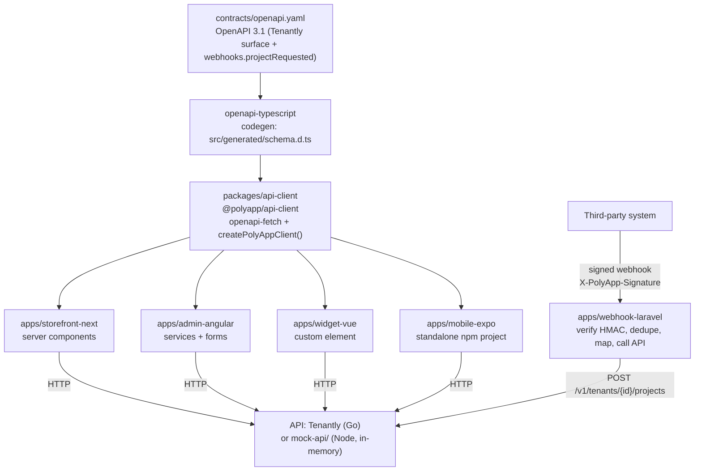

# PolyApp

[](https://github.com/OWNER/REPO/actions/workflows/ci.yml)

<!-- Placeholder: replace OWNER/REPO with the real GitHub path once the repository is published. -->

PolyApp is one API with several clients. The API contract comes from **[Tenantly](https://github.com/iboondk/tenantly)**, a multi-tenant Go service with tenants and projects. Tenantly does not publish an OpenAPI document, so this repo writes one (`contracts/openapi.yaml`) and generates every client from it.

- A shared TypeScript client generated from the spec (`packages/api-client`)
- A Next.js storefront that lists one tenant's projects (`apps/storefront-next`)
- An Angular admin back-office for tenants and projects (`apps/admin-angular`)
- A React Native (Expo) mobile project browser (`apps/mobile-expo`)
- A Vue custom element `<polyapp-projects>` for embedding (`apps/widget-vue`)
- A Laravel package that verifies signed webhooks and calls the API (`apps/webhook-laravel`)

> **Mock API notice.** Tenantly needs Postgres, Redis and Docker, which were not available when this was built. `mock-api/` is a zero-dependency Node test double with in-memory state that implements the same routes and error rules. It is **not** Tenantly itself. Point `POLYAPP_API_URL` at a real Tenantly server to use it.

## Architecture



Decisions behind this layout are recorded in [`docs/`](docs/): contract first ([ADR-0001](docs/ADR-0001-contract-first-openapi.md)), the mock API as a test double ([ADR-0002](docs/ADR-0002-mock-api-as-test-double.md)), a generated client with a thin runtime ([ADR-0003](docs/ADR-0003-generated-client-openapi-fetch.md)), and the Expo app outside the pnpm workspace ([ADR-0004](docs/ADR-0004-expo-outside-pnpm-workspace.md)).

## Quick start

### Option A: Docker Compose (mock API only)

```bash
docker compose up   # starts the mock API on http://127.0.0.1:4010 (no secrets needed)
curl -s http://127.0.0.1:4010/healthz   # {"status":"ok"}
```

Docker Compose runs only the mock API. The web, admin, widget and mobile apps are not containerised. Docker was **not installed** on the machine where this repo was built, so `docker-compose.yml` has been checked as YAML but not run.

### Option B: Node and pnpm (full demo)

Requirements: Node 24, pnpm 11.18.0.

```bash
pnpm install --frozen-lockfile
pnpm lint:spec                # redocly lint of the OpenAPI spec
pnpm build:client             # builds packages/api-client/dist
pnpm test:mock                # mock API unit tests
bash scripts/demo.sh          # end-to-end demo; prints a PASS / FAIL / SKIPPED table
```

`scripts/demo.sh` starts the mock API, regenerates the client and checks for drift, runs the end-to-end flow in `scripts/demo-flow.mjs`, and runs the client, widget, storefront and mobile tests. Pass `--full` to also build the storefront, run the Angular tests and build Angular. Laravel tests run only when PHP and Composer are installed. The script uses tool-default caches unless `POLYAPP_CACHE_DIR` points at a cache directory.

To run an app against the mock, start it with `node mock-api/server.mjs --port 4010`, then set the variables from the app's `.env.example`:

| App | Config file | Key variables |
| --- | --- | --- |
| Storefront | `apps/storefront-next/.env.example` | `POLYAPP_API_URL`, `POLYAPP_TENANT_ID`, `POLYAPP_DEV_EMAIL` |
| Mobile | `apps/mobile-expo/.env.example` | `EXPO_PUBLIC_POLYAPP_API_URL`, `EXPO_PUBLIC_POLYAPP_DEV_EMAIL` |
| Laravel adapter | `apps/webhook-laravel/.env.example` | `POLYAPP_API_URL`, `POLYAPP_SERVICE_TOKEN`, `POLYAPP_WEBHOOK_SECRET` |

A fresh mock has no tenants, and the mock keeps all state in memory, so restarting it clears everything. The storefront requests its dev token for `POLYAPP_DEV_EMAIL` (default `storefront@example.test`), and the API returns 404 to any email that is not a member of the tenant. Seed a tenant owned by that email before setting `POLYAPP_TENANT_ID`:

```bash
node mock-api/server.mjs --port 4010            # terminal 1, leave running
export POLYAPP_TENANT_ID=$(node scripts/seed-storefront.mjs)   # terminal 2, repo root
```

`scripts/seed-storefront.mjs` creates a dev token for `storefront@example.test`, one tenant and three projects (Alpha, Beta, Gamma). It prints only the tenant id. Run it again after every mock restart. To seed for a different email, set `POLYAPP_DEV_EMAIL` before running it, and use the same value for the app.

Every `.env.example` contains placeholders only. Never commit real values.

## Repository layout

| Path | Contents |
| --- | --- |
| `contracts/` | OpenAPI 3.1 spec, Redocly config, webhook fixture and expected signature |
| `mock-api/` | Zero-dependency Node mock of the Tenantly routes, with `node:test` tests |
| `packages/api-client/` | Generated types, `createPolyAppClient()`, webhook signing helper, vitest suite |
| `apps/storefront-next/` | Next.js App Router storefront |
| `apps/admin-angular/` | Angular standalone admin app (`ng test` uses Vitest) |
| `apps/widget-vue/` | Vue 3 custom element bundle, `<polyapp-projects>` |
| `apps/mobile-expo/` | Expo app, installed with npm outside the pnpm workspace |
| `apps/webhook-laravel/` | Laravel webhook adapter package with PHPUnit tests |
| `scripts/` | `demo.sh` and `demo-flow.mjs` |
| `docs/` | Architecture overview (`architecture.md`) and decision records |

## Testing and CI

The workflow in [`.github/workflows/ci.yml`](.github/workflows/ci.yml) defines two pipelines:

1. **workspace**: install with the frozen lockfile, lint the spec, regenerate the client and fail on drift, build the client, run the mock API, client, widget, storefront, Angular admin and mobile tests, then build the Angular admin and the storefront.
2. **laravel-adapter**: install with Composer and run PHPUnit.

The CI workflow has not yet run on GitHub, so its status is unverified. The badge at the top points at a placeholder path. Replace `OWNER/REPO` after publishing.

## Status and limitations

- The API is a mock. It has no persistence, no real auth, and the `/v1/auth/dev-token` route is for development only.
- The Laravel adapter's tests have been written but not run, because PHP and Composer were not installed.
- The Angular tests and build and the storefront production build run only with `bash scripts/demo.sh --full` (all passed locally).
- No performance or benchmark numbers are claimed.

See [WRITEUP.md](WRITEUP.md) for the problem, design choices, results and next steps, and [DEMO.md](DEMO.md) for a script to record a GIF or Loom demo.

## License

MIT. See [LICENSE](LICENSE). Copyright (c) 2026 iboondk.
